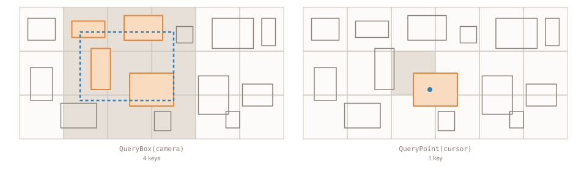
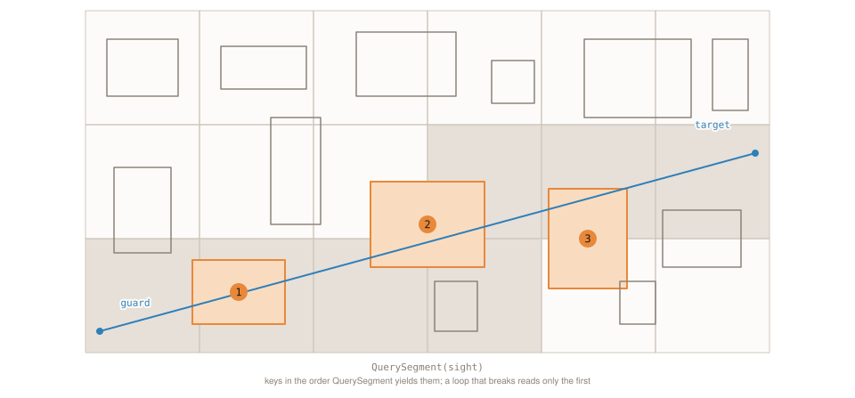

<div align="center" width="100%">

<a href="https://github.com/gravitton">
<picture>
  <source media="(prefers-color-scheme: dark)" srcset="https://raw.githubusercontent.com/gravitton/spatial/refs/heads/main/docs/images/logo-dark.svg">
  <source media="(prefers-color-scheme: light)" srcset="https://raw.githubusercontent.com/gravitton/spatial/refs/heads/main/docs/images/logo-light.svg">
  
</picture>
</a>

[![Latest Stable Version][ico-release]][link-release]
[![Build Status][ico-workflow]][link-workflow]
[![Coverage Status][ico-coverage]][link-coverage]
[![Go Dev Reference][ico-go-dev-reference]][link-go-dev-reference]
[![Go Version][ico-go-version]][link-go]
[![Software License][ico-license]][link-licence]

Broad-phase spatial indexes: a spatial hash, its box, point and cast queries, and touching pairs

<hr>

</div>

## Features

- **Generic** – any comparable key, any [`geometry`][link-geometry] number type for coordinates.
- **Broad phase only** – an index answers which keys may touch a region; the shapes decide.
- **Spatial hash** – `Hash`, a uniform grid of cells over an unbounded plane.

The rules behind them are in the [package documentation][link-go-dev-reference].

## Installation

```shell
go get github.com/gravitton/spatial
```

```go
import "github.com/gravitton/spatial"
```

## Usage

An index holds a key and a box per entity, and answers which keys may touch a region. The shapes
decide the rest.

```go
index := spatial.NewHash[Entity](64.0) // cells about the size of a typical entity

index.Set(player, shapes[player].Bounds()) // insert, or move after the entity moved
index.Delete(bullet)
```

### Collisions

```go
var pairs []spatial.Pair[Entity] // reused every frame, so the broad phase allocates nothing

pairs = index.AppendPairs(pairs[:0])
for _, pair := range pairs {
	if contact, ok := geom.Collide(shapes[pair.A], shapes[pair.B]); ok {
		resolve(pair.A, pair.B, contact)
	}
}
```

### Queries

The figures below store these boxes, one key each in the order given, in cells of 32:

```go
index := spatial.NewHash[int](32.0)

for key, box := range []geom.Box[float64]{
	geom.BoxFromMin(geom.Pt(6.0, 8.0), geom.Sz(20.0, 16.0)),
	geom.BoxFromMin(geom.Pt(38.0, 10.0), geom.Sz(24.0, 12.0)),
	geom.BoxFromMin(geom.Pt(52.0, 30.0), geom.Sz(14.0, 30.0)),
	geom.BoxFromMin(geom.Pt(76.0, 6.0), geom.Sz(28.0, 18.0)),
	geom.BoxFromMin(geom.Pt(114.0, 14.0), geom.Sz(12.0, 12.0)),
	geom.BoxFromMin(geom.Pt(140.0, 8.0), geom.Sz(30.0, 22.0)),
	geom.BoxFromMin(geom.Pt(8.0, 44.0), geom.Sz(16.0, 24.0)),
	geom.BoxFromMin(geom.Pt(30.0, 70.0), geom.Sz(26.0, 18.0)),
	geom.BoxFromMin(geom.Pt(80.0, 48.0), geom.Sz(32.0, 24.0)),
	geom.BoxFromMin(geom.Pt(98.0, 76.0), geom.Sz(12.0, 14.0)),
	geom.BoxFromMin(geom.Pt(130.0, 50.0), geom.Sz(22.0, 28.0)),
	geom.BoxFromMin(geom.Pt(162.0, 56.0), geom.Sz(22.0, 16.0)),
	geom.BoxFromMin(geom.Pt(150.0, 76.0), geom.Sz(10.0, 12.0)),
	geom.BoxFromMin(geom.Pt(176.0, 8.0), geom.Sz(10.0, 20.0)),
} {
	index.Set(key, box)
}
```

<p align="center">
<picture>
  <source media="(prefers-color-scheme: dark)" srcset="https://raw.githubusercontent.com/gravitton/spatial/refs/heads/main/docs/images/queries-dark.svg">
  <source media="(prefers-color-scheme: light)" srcset="https://raw.githubusercontent.com/gravitton/spatial/refs/heads/main/docs/images/queries-light.svg">
  
</picture>
</p>

```go
camera := geom.BoxFromMin(geom.Pt(44.0, 18.0), geom.Sz(68.0, 50.0))
cursor := geom.Pt(92.0, 60.0)

var keys []int

keys = index.AppendQueryBox(keys[:0], camera)   // what to draw
keys = index.AppendQueryPoint(keys[:0], cursor) // what is under the cursor
```

<p align="center">
<picture>
  <source media="(prefers-color-scheme: dark)" srcset="https://raw.githubusercontent.com/gravitton/spatial/refs/heads/main/docs/images/casts-dark.svg">
  <source media="(prefers-color-scheme: light)" srcset="https://raw.githubusercontent.com/gravitton/spatial/refs/heads/main/docs/images/casts-light.svg">
  
</picture>
</p>

```go
guard, target := geom.Pt(4.0, 90.0), geom.Pt(188.0, 40.0)

sight := geom.Seg(guard, target)
for key := range index.QuerySegment(sight) { // line of sight, stopping at the first wall
	if geom.Intersects(shapes[key], sight) {
		break
	}
}
```

Full reference: [pkg.go.dev][link-go-dev-reference].

## Credits

- [Tomáš Novotný](https://github.com/tomas-novotny)
- [All Contributors][link-contributors]

## License

The MIT License (MIT). Please see [License File][link-licence] for more information.


[ico-license]:              https://img.shields.io/github/license/gravitton/spatial.svg?style=flat-square&color=lightgrey
[ico-workflow]:             https://img.shields.io/github/actions/workflow/status/gravitton/spatial/main.yml?branch=main&style=flat-square
[ico-release]:              https://img.shields.io/github/v/release/gravitton/spatial?style=flat-square&color=e8883a
[ico-go-version]:           https://img.shields.io/github/go-mod/go-version/gravitton/spatial?style=flat-square&color=007d9c
[ico-go-dev-reference]:     https://img.shields.io/badge/go.dev-reference-007d9c?style=flat-square
[ico-coverage]:             https://img.shields.io/coverallsCoverage/github/gravitton/spatial?style=flat-square

[link-release]:             https://github.com/gravitton/spatial/releases
[link-go]:                  https://go.dev/doc/devel/release
[link-contributors]:        https://github.com/gravitton/spatial/contributors
[link-licence]:             ./LICENSE.md
[link-workflow]:            https://github.com/gravitton/spatial/actions
[link-go-dev-reference]:    https://pkg.go.dev/github.com/gravitton/spatial
[link-coverage]:            https://coveralls.io/github/gravitton/spatial
[link-geometry]:            https://github.com/gravitton/geometry
